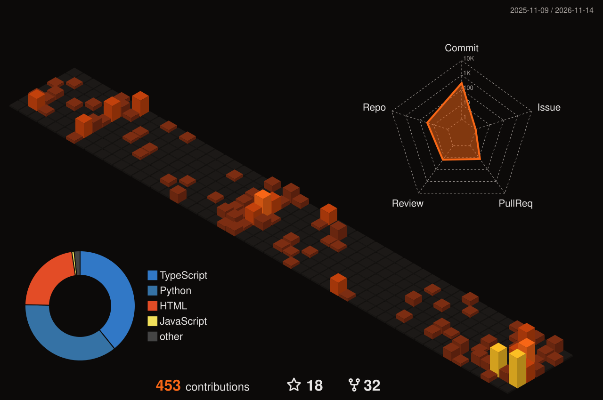

  
  
  
  
  
  

  
  
  
  
  

I build AI systems that have to work outside a demo: agents with hard constraints, models that run offline on a phone, and backends that hold up under load.

## Experience

| Role | Where | When |
|:---|:---|:---|
| **Project Engineering Intern** | Novabion Pvt. Ltd. Shipping Pashu Drishti, an offline-first edge AI system for livestock diagnostics | Oct 2026 to present |
| **Gen AI Intern** | AatonovaZ Technologies. LLM pipelines, evaluation and prompt engineering | Aug 2026 to present |
| **Open-source contributor** | Ubuntu, pandas and NumPy | Jan 2024 to present |

## Selected work

<table>
<tr>
<td width="50%" valign="top">

<h3><a href="https://github.com/balaraj74/Darwin">Darwin</a></h3>
AI executive board: 5 agents debate a startup plan over 3 rounds, with hard constraint vetoes.  
<code>FastAPI · Next.js · Vertex AI · Cloud Run</code>
</td>
<td width="50%" valign="top">

<h3><a href="https://github.com/balaraj74/VaidyaOS">VaidyaOS</a></h3>
Clinical AI that runs quantized LLMs on Android with no internet.  
<code>React Native · Gemma · llama.cpp</code>
</td>
</tr>
<tr>
<td width="50%" valign="top">

<h3><a href="https://github.com/balaraj74/CareerLens">CareerLens</a></h3>
32-service career intelligence platform. National winner, Google Gen AI Exchange.  
<code>Next.js · TypeScript · Gemini · Vector Search</code>
</td>
<td width="50%" valign="top">

<h3><a href="https://github.com/balaraj74/AgriSence">AgriSence</a></h3>
Crop disease detection and advisory in 7 Indian languages. 1st place, Inferentia 2.0.  
<code>Next.js · Gemini · Genkit · GCP</code>
</td>
</tr>
</table>

Also: [TaskForze](https://github.com/balaraj74/TaskForze) · [openNPC](https://github.com/balaraj74/openNPC) · [HealthMesh](https://github.com/balaraj74/HealthMesh) · [OmniSence](https://github.com/balaraj74/Omnisence)

## Stack

## Activity

## Recognition

<table>
<tr>
<td><b>National Winner</b> Google Gen AI Exchange, 2025</td>
<td><b>1st Place</b> Inferentia 2.0, 2025</td>
<td><b>Grand Finale</b> Meta PyTorch OpenEnv, 2026</td>
<td><b>Finalist</b> Google Gen AI Academy APAC, 2026</td>
</tr>
</table>

## Certifications

- Oracle Cloud Infrastructure Generative AI Professional
- Google Cloud Gen AI Academy APAC 2026, Cohorts 1 to 3
- 35+ verified badges on [Google Skills](https://www.skills.google/public_profiles/7e29917e-8bd6-41e6-8149-0795ae63c97b), Gold League
- HackerRank Frontend Developer (React) and JavaScript (Intermediate)

[All certificates](https://balaraj.me/#achievements)

## Writing

<!-- BLOG-POST-LIST:START -->
- [AgriSence: The AI Operating System for India&#39;s 140M Smallholder Farmers](https://balaraj.me/blogs/agrisence-ai-agricultural-operating-system) — *Jun 15, 2026*
- [Building Darwin: The AI Executive Board for Startup Founders](https://balaraj.me/blogs/building-darwin-ai-executive-board) — *Jun 12, 2026*
- [TaskForze: Autonomous Agent Swarm Orchestration with Dynamic Replanning](https://balaraj.me/blogs/taskforze-autonomous-agent-swarm-orchestration) — *Jun 10, 2026*
- [Building VaidyaOS: Offline Healthcare AI Using Edge AI](https://balaraj.me/blogs/building-vaidyaos-offline-healthcare-ai-edge-ai) — *May 29, 2026*
- [How AgriSence Uses AI for Crop Disease Detection](https://balaraj.me/blogs/how-agrisence-uses-ai-for-crop-disease-detection) — *May 28, 2026*<!-- BLOG-POST-LIST:END -->

## Connect

<table>
<tr><td><b>Portfolio</b></td><td><a href="https://balaraj.me">balaraj.me</a></td></tr>
<tr><td><b>Email</b></td><td><a href="mailto:balu.balarajr@gmail.com">balu.balarajr@gmail.com</a></td></tr>
<tr><td><b>LinkedIn</b></td><td><a href="https://www.linkedin.com/in/balarajr/">balarajr</a></td></tr>
<tr><td><b>X</b></td><td><a href="https://x.com/Balaraj__r">@Balaraj__r</a></td></tr>
<tr><td><b>Hugging Face</b></td><td><a href="https://huggingface.co/balarajr">balarajr</a></td></tr>
<tr><td><b>Kaggle</b></td><td><a href="https://www.kaggle.com/balarajr">balarajr</a></td></tr>
<tr><td><b>Google Developer</b></td><td><a href="https://g.dev/balarajr">g.dev/balarajr</a></td></tr>
<tr><td><b>Instagram</b></td><td><a href="https://www.instagram.com/balaraj.__r/">balaraj.__r</a></td></tr>
</table>

